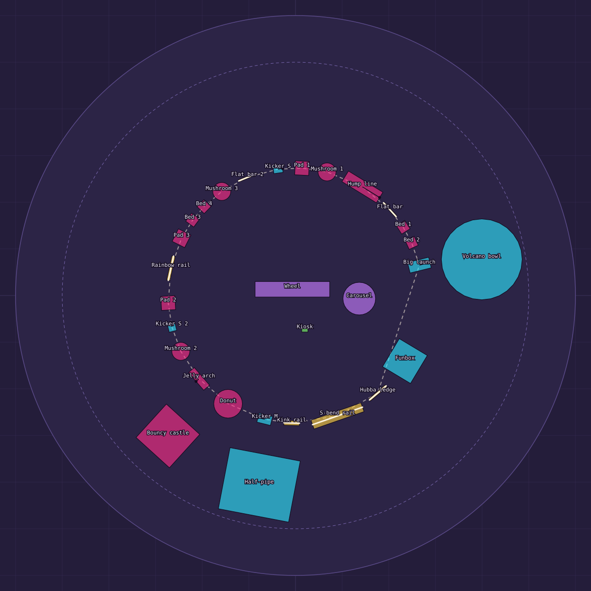
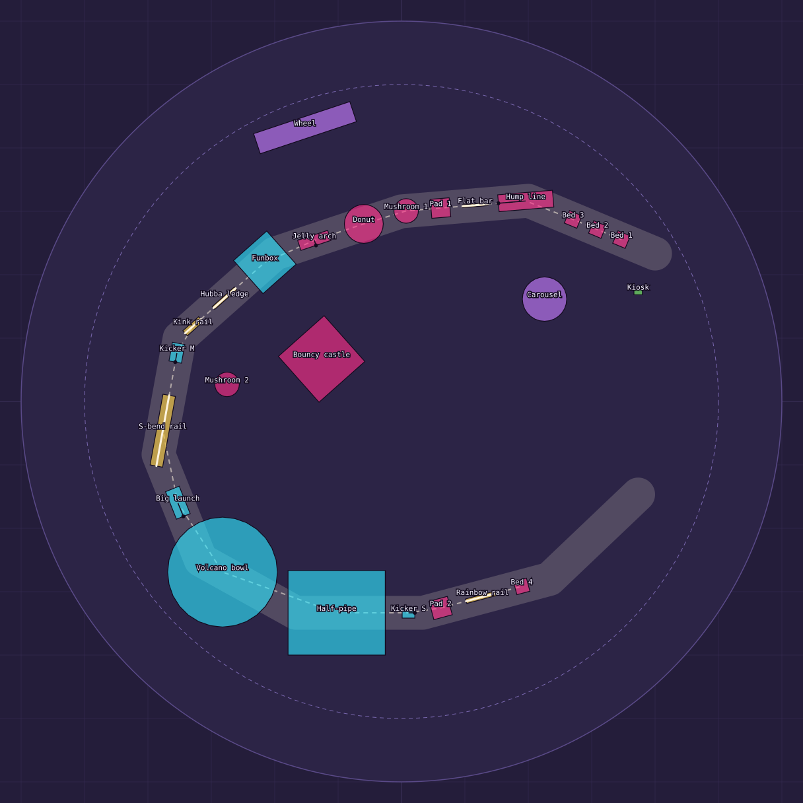

# The Funpark: two layouts for the combined bounce and skate park (proposal)

Status: the stray lamp posts, the light strings, the entrance arch with its "BOUNCE DOME FUNPARK" banner and the five bounce domes are **gone** (`src/settlements.js buildFunpark`; the
Asset Row's dome item with them). Everything below is a proposal: nothing of either layout is built yet. The plans and the spacing and chain checks are in `tools/funpark-layouts.mjs`
(`node tools/funpark-layouts.mjs docs` redraws `docs/funpark-layout-{current,a,b}.svg`; the same run checks the build circle, the gaps and every link of every line).

The frame is the funpark's own: metres, x across, z down the page; the plateau is flat out to 180 m, the build circle is **150 m**, and a rider needs a clear 3 m round every feature (6 m round a ride).

## What is wrong with it today

- Five domes of one shape, a castle and a row of four trampolines stand in groups 40-60 m apart: no step leads to the next, so nothing chains.
- The skate park is a separate block on the east side, 100 m from the nearest inflatable, and nothing in it grinds.
- The rides sit apart in the west; the entrance was an arch over the track.

## The new set of pieces (a Blender kit, `tools/blender/build_funpark.py` -> `src/assets/funpark.glb`, built when a layout is chosen)

Every piece is remodelled (the castle, trampolines, bowl, half-pipe, funbox, kickers, ferris wheel and carousel are new models; the domes are gone), in a lacquered
candy palette that matches the casino's craftsmanship: one material per mesh, no two faces on one plane (`audit_coplanar`), an Asset Row item each.

| Piece | Size | Bounces / grinds | What it is |
|---|---|---|---|
| Pillow pad | 9 x 9 x 1.3 m | **bounces** (a low springy box) | a scalloped inflatable cushion, seamed in two colours: the soft landing and the first bounce of a line |
| Trampoline bed | 6.4 x 6.4 x 0.9 m | **bounces** | a sprung bed in a padded frame on short legs, a glowing ring in its mat |
| Mushroom | cap r 5.8, 6.5 m tall | **bounces** (the cap) | a tall stem and a domed cap: a high, narrow bounce that throws you over what is next |
| Hump line | 8 x 26 x 2.6 m | **bounces** (three humps) | three inflated humps in a row to pump over |
| Donut ring | r 9.2, 4.4 m tall | **bounces** (a ring of springy bumpers) | a big inflatable torus: bounce across its rim or through the hole |
| Jelly arch | 15 x 5 x 6 m | **bounces** (the legs), **grinds** (the crest) | an inflatable archway with a rail along its crest |
| Bouncy castle | 29 x 29 x 14 m | **bounces** (walls and turrets), **grinds** (battlements) | the castle, remade: four turrets, a drawbridge that is a launch ramp, a rail along each wall top |
| Small / medium / big kicker | 6, 9, 14 m long | launch 6-14, 9-18, 14-26 m | launch ramps with striped decks, glowing rails and a coping bar |
| Volcano bowl | r 26, 4.2 m rim | **grinds** (the lip, a closed loop) | the bowl remade with a coping loop all the way round |
| Half-pipe | 46 x 40 x 9 m | **grinds** (both copings, the stair rails) | two matching walls, decks, stairs, tiles, copings |
| Pyramid funbox | 21 x 21 x 2.6 m | **grinds** (a hubba ledge along one side) | four ramps and a flat top |
| Flat bar | 12 m, 0.9 m high | **grinds** | a bar on two posts |
| Hubba ledge | 14 m, 0.8 m high | **grinds** | a low ledge with a rail along its top edge |
| Kink rail | 10 m, falling 2.6 m | **grinds** | a rail down a flight of stairs with a kink |
| S-bend rail | 34 m, 1 m high | **grinds** | a long wavy rail, the snake rock's crest as a ride |
| Rainbow rail | 16 m, 3.2 m high | **grinds** | an arched rail on pillars |
| Ferris wheel | R 22, platform 16 x 10 | rideable (as now) | remade: a trussed A-frame, lit rims, twelve open gondolas |
| Carousel | r 10.5 | rideable (as now) | remade: a striped canopy, lit, eight horses |
| Ticket kiosk | 4 x 3 m | | the booth, remade |

### How grinding is added (engine side; built with the layout)

`rails.js` already lets a rider lock to any polyline in `planet.rails` (a snake rock's crest or a crater lip): land on it or skate into its tip. The funpark registers its own:
`World.rail(loc, pts, { loop })` turns a polyline in the funpark's frame into world points and `planet.addRail`s it (`addRail` returns the rail, `removeRail` takes it down, `rebuildLocation` clears them);
a closed loop (the bowl's lip, the castle's battlements) sets `rail.loop` as crater lips do. A support the rail sits on (the ledge, the posts, the arch) carries `collider.rail = rail.pts`, so a rider on the rail does not
knock against it (`Grinder.hit`). Rails are 8-34 m, 0.8-3.2 m high, and their ends meet the ground or a ramp so the tip scoops take a rider onto them.

## Layout A: The Loop

One continuous circuit (a ring 82 m in radius) of 30 elements, ridden either way round, with the rides in the middle. The big features (the volcano bowl, the half-pipe, the castle) stand just
outside the ring and are reached by a launch off it; the line carries on past them. A walker crosses the middle (the wheel, the carousel, the kiosk) without crossing the line.



The line, in order round the ring from the north: Small kicker, Pad 1, Mushroom 1, Hump line, Flat bar, Bed 1, Bed 2, **Big launch (out to the Volcano bowl)**, Funbox, Hubba ledge, S-bend rail,
Kink rail, Medium kicker, Donut, Jelly arch, Mushroom 2, Small kicker 2, Pad 2, Rainbow rail, Pad 3, Bed 3, Bed 4, Mushroom 3, Flat bar 2, and round to the start. The half-pipe and the castle sit outside
the south and west of the ring.

## Layout B: The Spine

One long street from the gate in the north-east round to the far end in the south, a gradient from soft and small to hard and big (26 elements). The rides stand along its flanks (the carousel at the gate, the
wheel on the far side), the castle in the park's middle (a mushroom between the street and the castle is the way over to it).



The line, in order from the gate: Beds 1-3, Hump line, Flat bar, Pad 1, Mushroom 1, Donut, Jelly arch, Funbox, Hubba ledge, Kink rail, Medium kicker, S-bend rail, **Big launch into the Volcano bowl**, the Half-pipe
and a cool-down back toward the gate (Small kicker, Pad 2, Rainbow rail, Bed 4).

## Which links work (checked by the script)

Each step names how a rider gets from one element to the next and the gap it needs: a launch comes off a kicker and lands 6-26 m on (by its size, within 40 degrees of its heading), a bounce lands within a
radius of the next bouncy thing, a rail you pop off carries you on along its line 3-14 m. Both layouts pass every check: no element within 3 m of another (6 m of a ride), everything inside the 150 m circle, every
link inside its range.

Layout A:

```
Kicker S -> Pad 1 (launch) 8 m, 7 deg off
Pad 1 -> Mushroom 1 (bounce) 8 m
Mushroom 1 -> Hump line (bounce) 9 m
Hump line -> Flat bar (carry) 4 m, 21 deg off
Flat bar -> Bed 1 (pop) 5 m, 9 deg off
Bed 1 -> Bed 2 (bounce) 7 m
Bed 2 -> Big launch (bounce) 15 m
Big launch -> Volcano bowl (launch) 21 m, 10 deg off
Hubba ledge -> S-bend rail (pop) 6 m, 6 deg off
Kink rail -> Kicker M (carry) 8 m, 6 deg off
Donut -> Jelly arch (bounce) 20 m
Jelly arch -> Mushroom 2 (pop) 16 m, 104 deg off
Mushroom 2 -> Kicker S 2 (bounce) 11 m
Kicker S 2 -> Pad 2 (launch) 8 m, 7 deg off
Rainbow rail -> Pad 3 (pop) 8 m, 12 deg off
Pad 3 -> Bed 3 (bounce) 8 m
Bed 3 -> Bed 4 (bounce) 7 m
Bed 4 -> Mushroom 3 (bounce) 8 m
Mushroom 3 -> Flat bar 2 (bounce) 10 m
```

Layout B:

```
Bed 1 -> Bed 2 (bounce) 8 m
Bed 2 -> Bed 3 (bounce) 8 m
Bed 3 -> Hump line (bounce) 12 m
Hump line -> Flat bar (carry) 5 m
Flat bar -> Pad 1 (pop) 6 m, 0 deg off
Pad 1 -> Mushroom 1 (bounce) 8 m
Mushroom 1 -> Donut (bounce) 9 m
Donut -> Jelly arch (bounce) 20 m
Jelly arch -> Funbox (pop) 18 m, 90 deg off
Funbox -> Hubba ledge (ride) 15 m
Hubba ledge -> Kink rail (pop) 8 m, 0 deg off
Kink rail -> Kicker M (carry) 6 m, 16 deg off
Kicker M -> S-bend rail (launch) 16 m
S-bend rail -> Big launch (pop) 13 m, 45 deg off
Big launch -> Volcano bowl (launch) 20 m, 13 deg off
Volcano bowl -> Half-pipe (drop) 37 m
Kicker S -> Pad 2 (launch) 8 m, 11 deg off
Rainbow rail -> Bed 4 (pop) 8 m, 0 deg off
```
