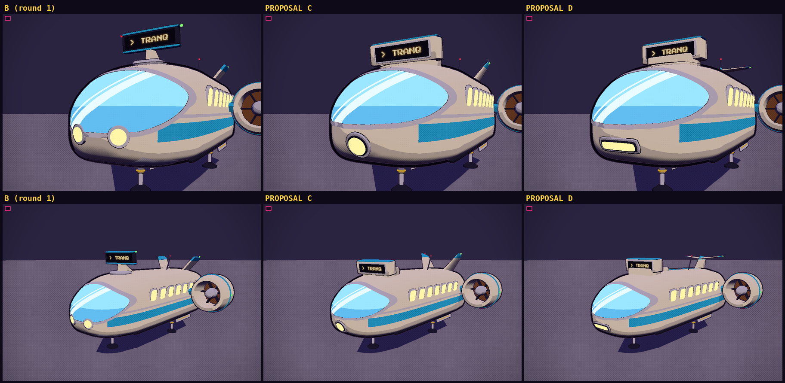
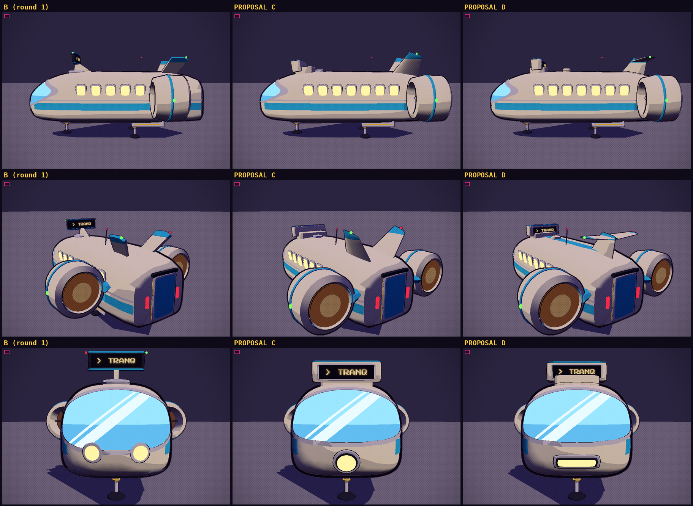
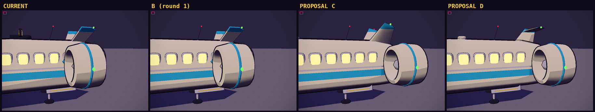
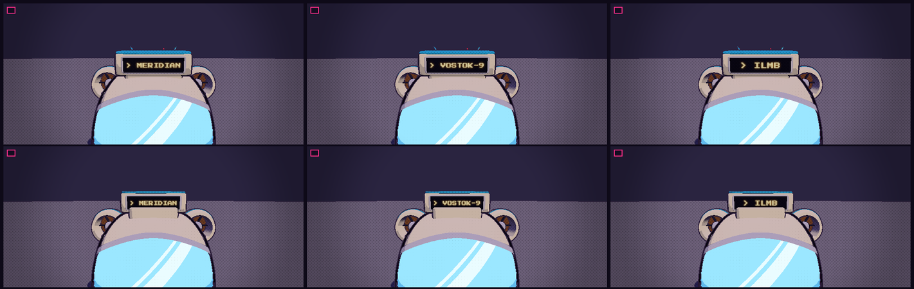

# Shuttle-bus proposals

The shuttle-bus (`tools/blender/build_ships.py` -> `src/assets/ships.glb`) is a good size and shape, so this is polish. Round 1
(A and B) reworked the windscreen and the route board. Round 2 (C and D) mixes what was liked in both and adds three more fixes.

## Round 2: C and D

What was asked for, and what both new builds do about it:

- **Bubble cockpit, with the silver trim.** B's single sheer visor (no pillars) in its silver bezel, with the horizon tint and the
  reflection streaks. The streaks are cleaner than in round 1: the old one used a single cut for both bands, which skipped a band
  narrower than a mesh cell and left a stair-stepped edge near the nose; each band edge is now its own exact cut.
- **A's blockier board, as part of the frame.** The route board is a hull-coloured block with a livery cap, now with a silver frame round
  its dark panel to match the windscreen's trim.
- **One large central headlight under the cockpit** instead of two. The glass's lower edge is lifted a little at the chin to give it room.
- **Refined tail fins.** The old fins were flat extruded plates. The new ones are lofted through airfoil sections (`airfoil_fin()`): tapered,
  raked, with a round leading edge, a fine trailing edge and a rounded tip, shaded smooth, with the livery as a band across the outer
  fifth and a nav light on the tip.
- **Engines clear of the passenger windows.** In the shipped model (and in A and B) the pylon carrying each side engine passes
  through the two rearmost windows, and the duct comes within 0.13 m of another. In C and D the engines sit right aft (z -7.7 instead of -5.0),
  the pylon is shorter and ends inside the hull's length, and the window row starts further forward and is spaced a little tighter (all
  seven windows kept). The build measures it: the pylon and duct stop **0.75 m / 0.55 m behind the rearmost window's rim**, and
  `build_ships.py` fails if a change brings the engines within 0.3 m of the windows.






### Proposal C: "Bubble Block"

- **Lamp:** a round lamp, a silver rim round a dark well round the lit lens, centred under the visor.
- **Board:** a header board built into the roofline **just over the windscreen** (3.4 x 0.85 m, one face), on a plinth running back into the
  roof, its face leaning forward and down a little like the nose. The sensor blister sits behind it.
- **Tail:** a refined **V-tail**: two airfoil fins canted 0.55 rad, 2.9 m long, tapering from a 3.2 m to a 1.45 m chord, banded in the livery.
- Reads as: the same shuttle as before with every part tidied (the nearest to the shipped silhouette).

### Proposal D: "Bubble Spine"

- **Lamp:** a wide, pill-shaped light bar (a silver rim, a dark well, a lit strip) centred under the visor.
- **Board:** a **double-faced block** on the roof where the old disc sat (3.2 x 0.8 m, readable from the front and the back), on a body-coloured
  base, joined to the tail by a **livery-colour rail** along the roof: the board reads as the front of the bus's frame.
- **Tail:** a **dorsal fin with stabilisers across its top** (a T-tail): one swept airfoil fin on the centreline, 2.55 m tall, banded in the
  livery at the tip, with a stabiliser either side carrying the red and green lights.
- Reads as: a bigger change to the silhouette (the V-tail goes), with a stronger "one built frame" look from nose to tail.

Cost: C is about 25.5k triangles for the shuttle and D about 26.7k (the shipped model: 23.5k), before outlines. The files are about 1.3 MB
each, like `ships.glb` (they contain the freighter, unchanged).

---

## Round 1: A and B

The shuttle-bus (`tools/blender/build_ships.py` -> `src/assets/ships.glb`) is a good size and shape; the first pass was
polish on two things:

1. **The front windscreen.** The glass was a flat, unlit cyan slab with a stair-stepped edge (the old script kept or
   dropped whole hull faces, so a cut across the quads came out as a sawtooth), a heavy black frame, and headlights
   that sat inside the hull (so they drew as dark blobs). The hull's nose was also faceted (five long panels).
2. **The route board.** It was a small amber box on a stand amidships, with no text. It now sits at the front of the
   roof (where the sensor disc was), and **shows where the bus is bound**, in the game's pixel font on a dot-matrix
   panel.

Both proposals share the fixes underneath, and differ in how the nose and the board look.


### What both fix

- **Clean glass edges.** The new `clipf()` cuts a dense patch of the hull's skin exactly where a smooth field crosses
  zero, so every edge of the glass, frame and bezel is a clean curve, with rounded corners.
- **Glass with some depth.** The glass is split into three tints (new slots `glass`, `glassDeep`, `glassHi`: a sky
  tint, a deeper tint under a horizon line, and white reflection streaks), cut from the same patch so nothing
  overlaps or fights for depth.
- **Nose lamps set on the skin** (`stick()` finds the hull surface and its normal), with rims, instead of buried in it.
- **A rounder nose** (the hull sections are re-cut along monotone cubic curves, same shape, no facets), with the
  livery belt following it, and a slim skid plate under the nose instead of two dark lumps.
- **The route board pivot.** A new pivot role, `board`, in the model: it sits at the middle of the display face
  (`+z` out of it) and carries `w`, `h`, `faces` and `depth` as custom properties. The game draws the lit text on it
  (`makeShip` in `src/models.js`: a canvas in the pixel font, amber lettering on a dark dot-matrix panel, shrunk to
  fit). `ship.setSign(text)` changes it.
- **The sign follows the route.** `Traffic.updateFlyer` sets each visible bus's board to the short name of the stop it
  is bound for (the far end while it flies, the other end while it waits at a pad: `> TRANQ`, `> VOSTOK-9`). The
  medevac, recall and spindle-pod shuttles label themselves `MEDEVAC`, `RECALL` and `EXTRACT`. Until a model with a
  `board` pivot is installed none of this shows: the shipped `ships.glb` has no board, so `setSign` does nothing.

Cost: about 25k triangles for the shuttle (the old one was 23k), before outlines. (Round 1 left the side engines where they were, so
A and B still have the engine clip described below; the streaks on A and B's glass were re-cut with round 2's fix.)

### Proposal A: "Cockpit"

A classic airliner flight deck.

- **Windscreen:** a three-pane wraparound visor. Two body-coloured pillars split the glass; a thin dark gasket runs
  round it; the header is a shallow arch, so there is a hull-coloured brow over the glass. Reflection streaks cross
  all three panes as one continuous glint.
- **Lamps:** slim, wide LED bars on the cheeks under the visor, in light-grey rims.
- **Board:** a header board **integrated into the roof, just over the windscreen** (3.4 x 0.85 m, one face). It is a
  hull-coloured housing on a plinth that runs back into the roofline, with a livery-colour cap, its face leaning
  forward and down a little (like the nose, and so it reads from a pad below). The sensor blister moves back behind it.
- Reads as: the bus's "headboard", part of the vehicle.

### Proposal B: "Bubble"

A friendlier face: the shuttle's "fat, friendly hopper" character turned up.

- **Windscreen:** one big goggle-shaped visor with a chunky light-grey trim bezel and a slim dark gasket inside it,
  a horizon tint and a single bold reflection streak. No pillars: nothing between you and the view.
- **Lamps:** big round headlights with round rims (the bus gets two eyes).
- **Board:** a **double-faced lightbox on a swept roof fin, standing on the sensor puck** where the old disc sat
  (3.4 x 0.85 m, the text reads from the front and the back). Dark housing with livery caps and port/starboard
  pips on its ends, tipped forward a little.
- Reads as: a rooftop sign, like a taxi's: a separate object you can see from a long way off, and from behind.

## Preview them

Run `npm run dev` and open (the models are in `src/assets/proposals/`, with the same numbers and rig as `ships.glb`):

```
/tools/viewer.html?m=shuttle&ships=/src/assets/proposals/ships_A.glb&sign=TRANQ&yaw=30&pitch=6&dist=20&at=0,5.5,4
/tools/viewer.html?m=shuttle&ships=/src/assets/proposals/ships_B.glb&sign=MERIDIAN&yaw=30&pitch=6&dist=20&at=0,5.5,4
/tools/viewer.html?m=shuttle&ships=/src/assets/proposals/ships_C.glb&sign=TRANQ&yaw=30&pitch=6&dist=20&at=0,5.5,4
/tools/viewer.html?m=shuttle&ships=/src/assets/proposals/ships_D.glb&sign=TRANQ&yaw=140&pitch=14&dist=20&at=0,6.2,-4
```

`ships=` loads any ships file in place of `src/assets/ships.glb` (dev viewer only), and `sign=` sets the board's text.
(The viewer lifts the shuttle by its gear height, 4.6 m, so add that to the `y` of `at=`.)

## Rebuild or adopt one

`tools/blender/build_ships.py` has all five builds in it; `SHUTTLE_VARIANT` picks one: `current` (the default: what
ships now, unchanged), `A`, `B`, `C` or `D`. `SHIPS_OUT` sets where the file goes (default `src/assets/ships.glb`).

```
MOONRUNNER_REPO=. SHUTTLE_VARIANT=C blender -b -P tools/blender/build_ships.py   # (or `pip install bpy` and run it with python)
npm run optimize:glb                                              # compress it like the others
```

To adopt a proposal: either copy its file over `src/assets/ships.glb` (the proposals are already compressed and
contain the freighter unchanged), or rebuild as above. Once one is chosen, the other builds and the `current` branch
can be deleted from the script (and the proposal files from `src/assets/proposals/`).
